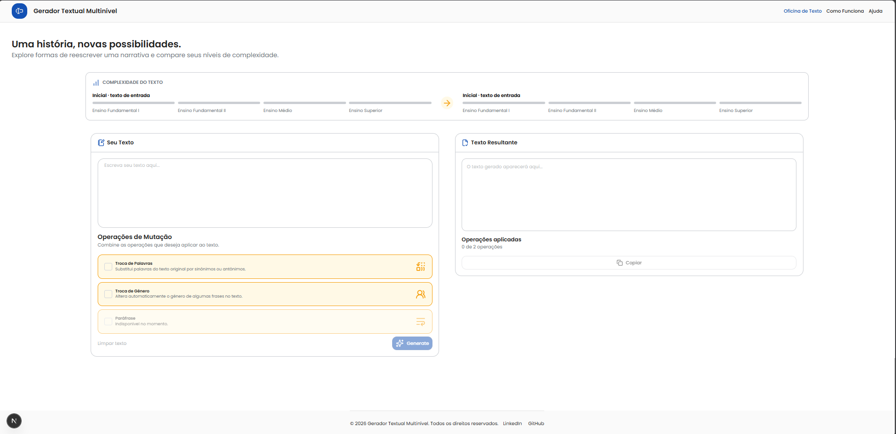
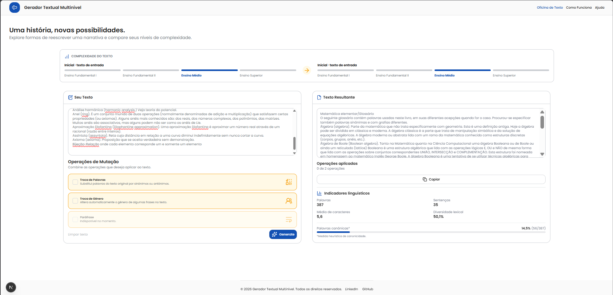

<div align="center">
  
  
  
  
  <br />
  
  
  
  
  
</div>
<br />

# Multilevel Text Generator

A aplicação **Multilevel Text Generator** é um sistema avançado desenvolvido para auxiliar na automação e análise da criação de textos focados em testes de capacidade de leitura. O projeto permite gerar versões mutadas de uma narrativa curta e analisar, em tempo real, como essas alterações e heurísticas impactam a complexidade prevista do texto.

## 💻 Telas da Aplicação

*(As imagens demonstram a interface responsiva desenvolvida para a comparação de textos e exibição dos indicadores de complexidade linguística).*






## 🚀 Funcionalidades

O fluxo central da aplicação permite o processamento de ponta a ponta:
*   **Entrada de Texto**: Permite ao usuário inserir um texto original para ser analisado e transformado. O sistema exibe um aviso contextual caso o texto inserido possua menos de 100 palavras para garantir a precisão da análise.
*   **Transformação Textual**: Geração de uma versão modificada do texto com base na seleção de operações heurísticas avançadas de mutação.
*   **Classificação de Complexidade**: Avaliação do texto original e do texto gerado, classificando-os em quatro níveis de ensino: Ensino Fundamental I (EF1), Ensino Fundamental II (EF2), Ensino Médio (EM) e Ensino Superior (ES).
*   **Dashboard Comparativo**: Apresenta a classe prevista e as probabilidades do modelo de Machine Learning por classe. Exibe estatísticas descritivas para o texto, como número de palavras, número de sentenças, comprimento médio das palavras, diversidade lexical e a porcentagem de palavras que atendem à heurística de canonicidade.

## 🛠 Arquitetura e Stack Tecnológico

A solução foi estruturada com uma arquitetura moderna, separando as responsabilidades de interface (client-side) e processamento analítico (server-side).

*   **Frontend**: Construído com Next.js, React, TypeScript, Tailwind CSS e Lucide React. O frontend gerencia a entrada de texto, a seleção de operações, e apresenta o dashboard interativo de resultados.
*   **Backend / API**: Desenvolvido em Python com FastAPI e Pydantic para validação robusta das requisições e orquestração do pipeline de processamento assíncrono.
*   **NLP e Machine Learning**: spaCy (modelo `pt_core_news_lg`), scikit-learn, NumPy, pandas e joblib. Responsáveis pela análise linguística profunda, extração de features textuais, treinamento e inferência do modelo de classificação.
*   **Dados Lexicais**: Dicionário estruturado de sinônimos e antônimos convertido para o formato JSON, originado a partir do recurso TeP 2.0 (via `stavarengo/portuguese-brazilian-synonyms`).

## 🧠 Classificador de Complexidade

O classificador foi treinado sobre um dataset rigoroso de 2.076 arquivos de texto extraídos de materiais didáticos do MEC. O treinamento utilizou um particionamento estratificado de 80% para treino e 20% para validação e teste.

*   **Modelo**: `HistGradientBoostingClassifier` da biblioteca scikit-learn, configurado e otimizado com `max_iter=400`, `max_depth=6`, `learning_rate=0.05` e `max_leaf_nodes=31`.
*   **Representação Textual**: Utiliza um vocabulário TF-IDF (unigramas e bigramas, limitados a 5.000 features) reduzido dimensionalmente por `TruncatedSVD` com 100 componentes principais.
*   **Features Linguísticas**: O modelo incorpora um vetor com 31 características linguísticas adicionais elaboradas via spaCy. Essas características englobam propriedades estruturais, riqueza lexical, proporção de classes gramaticais, relações sintáticas e marcas morfológicas complexas.
*   **Feature de Canonicidade**: Implementação heurística personalizada que verifica pares de caracteres seguindo o padrão consoante-vogal (CV), atribuindo um escore por token. O modelo de predição consome a média, a dispersão e a proporção de palavras com escore perfeito.

### 📊 Resultados no Conjunto de Teste

No conjunto de teste isolado (416 documentos), o modelo apresentou métricas de alta performance:
*   **Acurácia**: 91,35%
*   **F1 Macro**: 90,24%

O nível Ensino Superior (ES) apresentou o maior F1-score (0,94), enquanto o Ensino Fundamental II (EF2) alcançou 0,87. A matriz de confusão aponta que os principais desvios ocorrem apenas entre classes limítrofes, com destaque para a leve sobreposição natural entre textos de transição do EF1 para o EF2.

## 🧬 Operadores de Mutação

A aplicação integra heurísticas textuais inteligentes para alterar as frases de entrada, mantendo a coerência semântica sempre que possível. O endpoint de geração devolve o texto processado e a trilha de auditoria das operações aplicadas.

1.  **Troca de Palavras**: Substitui aleatoriamente até cinco palavras-chave do texto por seus sinônimos ou antônimos consultando a base lexical JSON. A heurística prioriza candidatos baseando-se na similaridade vetorial de word embeddings (spaCy) e aplica lógicas de flexão gramatical (gênero e número), limitando de forma inteligente a substituição de verbos conjugados.
2.  **Troca de Gênero**: Altera o sujeito das frases utilizando pares mapeados de substantivos e adjetivos masculinos/femininos. Após a alteração central, o operador percorre as árvores de dependência sintática do spaCy para reajustar automaticamente a concordância de artigos e adjetivos conectados.
3.  **Paráfrase (Em desenvolvimento)**: O controle visual existe na interface para demonstrar a escalabilidade do sistema. O desenvolvimento deste operador está planejado para o próximo ciclo de releases. A API lança um erro HTTP 422 adequado caso essa operação seja requerida precocemente.

## ⚙️ Instalação e Execução

### Artefatos Necessários
*   O arquivo do modelo serializado `modelo_complexidade.joblib` deve estar alocado no diretório `backend/app/ml/models/`.
*   O arquivo de base lexical `output.json` precisa estar acessível na raiz do projeto backend.

### Execução do Backend (API)
Utilizando um terminal na raiz do backend, crie seu ambiente virtual (recomendado) e execute os comandos:
```bash
cd multilevel-text-generator-app/backend
python -m pip install -r requirements.txt
python -m spacy download pt_core_news_lg
python -m uvicorn app.main:app --reload
